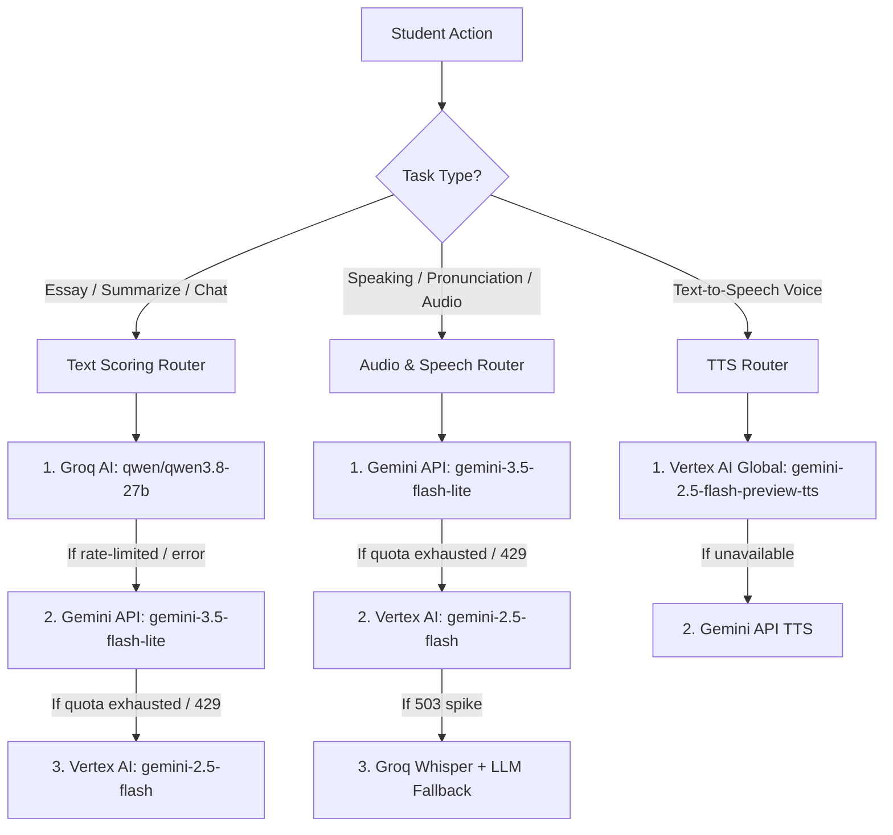

# PTE Ninja — 3-Tier AI Engine Architecture

This document provides a technical deep-dive into the AI pipeline powering PTE Ninja's scoring and evaluation engines.

---

## 1. Engine Hierarchy & Selection Logic

PTE Ninja employs a resilient, cost-optimized **3-Tier AI Architecture**:

---

## 2. Tier Details & Responsibilities

### Tier 1: Groq AI (`qwen/qwen3.8-27b`)
* **Role**: Primary engine for Writing tasks (Write Essay, Summarize Written Text) and Customer Support Chat.
* **Latency**: **~750ms** (fastest in the industry).
* **Cost**: **100% Free** via Groq Cloud API.
* **Why it matters**: By offloading writing and chat to Groq, student practice does not consume your Google Cloud credits or Gemini quotas.

### Tier 2: Gemini Developer API (`gemini-3.5-flash-lite`)
* **Role**: High-volume, free multimodal scoring.
* **Quota**: **1,500 requests per day (RPD)**, **15 requests per minute (RPM)**.
* **Cost**: **$0.00** (Free Tier).
* **Reset**: Resets daily at midnight Pacific Time.
* **Controlled by**: `PREFER_FREE_GEMINI=true`.

### Tier 3: Google Cloud Vertex AI (`gemini-2.5-flash` & `gemini-2.5-flash-preview-tts`)
* **Role**: Enterprise-grade speech scoring, pronunciation analysis, and 24 kHz Text-to-Speech audio generation.
* **Authentication**: Service Account OAuth2 via `FIREBASE_SERVICE_ACCOUNT` (Role: `Agent Platform User`).
* **Location**: `global` (required for TTS preview models on Vertex AI).
* **Cost**: **Funded by your $300 Google Cloud Credit** (~1 Billion tokens capacity).
* **Privacy**: Enterprise SLA; student data is never used to train public models.

---

## 3. Resilience & Failure Handling

1. **Quota Exhaustion (HTTP 429)**:
   * When a key hits quota, `server.ts` calculates exponential backoff:
     $$\text{Cooldown} = \min(60\text{s} \times 2^{\text{hits}}, 3600\text{s})$$
   * The key is cooled down in memory and marked in Firestore, automatically promoting the next key in the pool.
2. **Transient Model Spikes (HTTP 503 / 500)**:
   * Retries twice on the same key with linear backoff (1s, 2s) to ride out momentary model load spikes.
   * If retries fail, seamlessly fails over to the next tier without returning an error to the student.
3. **Prompt Injection Hardening**:
   * All user inputs passed to the AI prompt are sanitized via `sanitizePromptValue(input, maxLength)` to prevent prompt injection and token flooding attacks.
